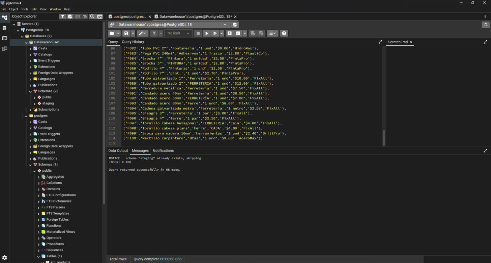
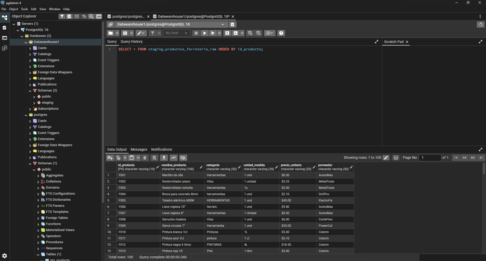
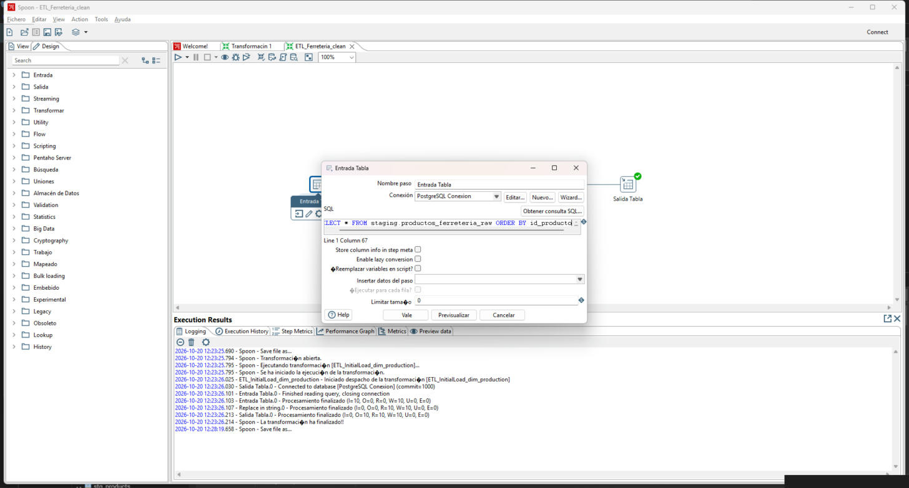
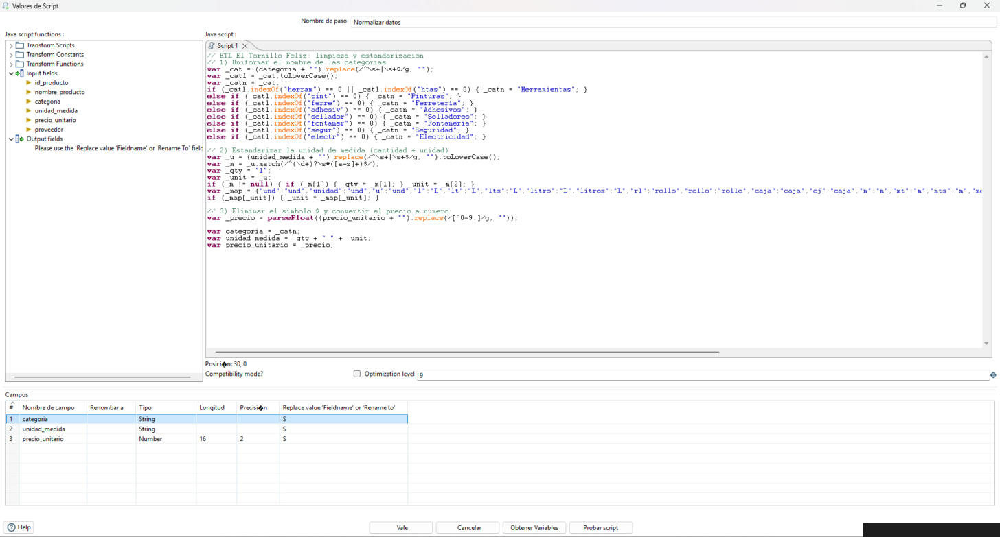
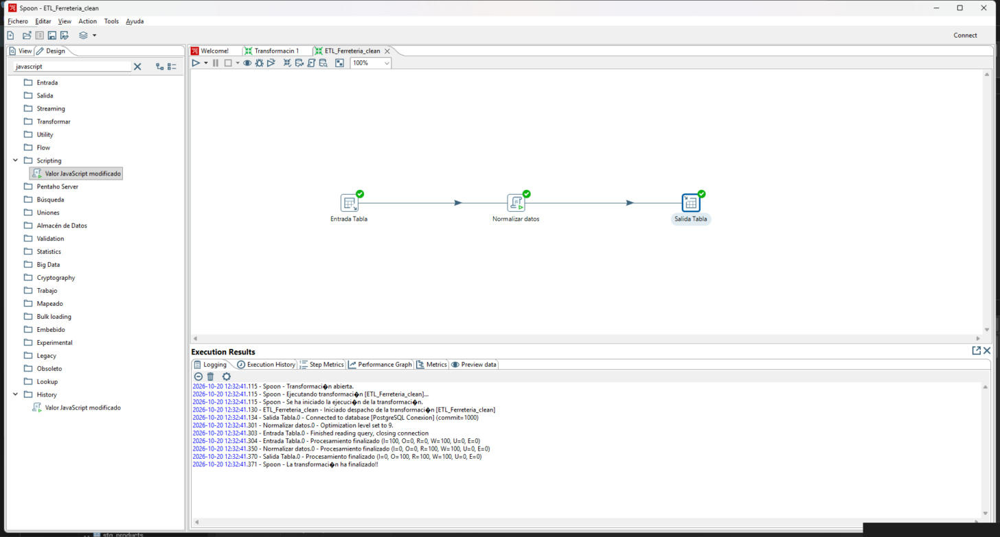
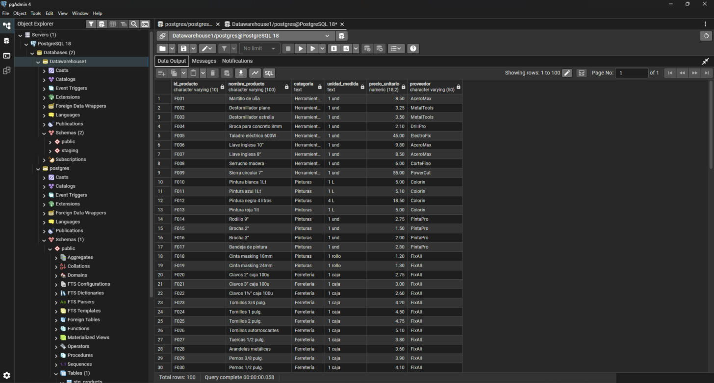
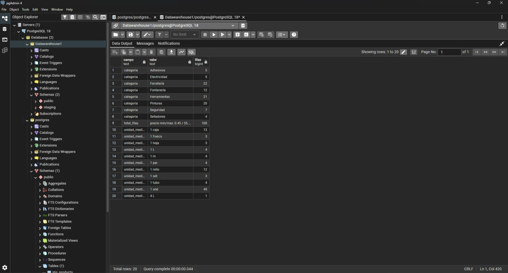

<div align="center">

# ESCUELA POLITÉCNICA NACIONAL
### Facultad de Ingeniería de Sistemas

**Asignatura:** Business Intelligence
**Paralelo:** GR2SW

## Trabajo grupal. ETL de limpieza de datos con Pentaho Data Integration – Ferretería El Tornillo Feliz

**Integrantes:**
- Alvaro Montalvan
- Ruben Cuenca
- Jonathan Cuasapaz
- Jeremy Jimenez

**Fecha:** 20/10/2026

</div>

---

## Índice

1. [Introducción](#intro)
2. [Objetivos](#objetivos)
3. [Desarrollo](#desarrollo)
   - 3.1 [Problema a resolver](#problema)
   - 3.2 [Creación de la tabla raw](#raw)
   - 3.3 [Diseño de la transformación en Pentaho](#diseno)
   - 3.4 [Ejecución](#ejecucion)
   - 3.5 [Verificación de resultados](#resultados)
4. [Conclusiones](#conclusiones)
5. [Referencias](#referencias)
6. [Declaración de uso de inteligencia artificial](#ia)

---

## Índice de figuras y tablas

### Figuras

- [Figura 1. Script de la tabla productos_ferreteria_raw en pgAdmin](#fig1)
- [Figura 2. Datos originales de la ferretería](#fig2)
- [Figura 3. Configuración del paso Entrada Tabla](#fig3)
- [Figura 4. Paso de normalización con JavaScript](#fig4)
- [Figura 5. Ejecución de la transformación ETL_Ferreteria_clean](#fig5)
- [Figura 6. Tabla productos_ferreteria_clean con los datos limpios](#fig6)
- [Figura 7. Consulta de verificación de categorías y unidades](#fig7)

### Tablas

- [Tabla 1. Problemas de los datos y regla de limpieza](#tabla1)

---

<a id="intro"></a>
## 1. Introducción

La Ferretería El Tornillo Feliz tiene varias sucursales y cada una lleva su inventario a mano. Por eso los datos llegan desordenados: las categorías se escriben de varias formas, los precios incluyen el símbolo $ y las unidades de medida no son iguales.

En este trabajo se realizó un proceso ETL (extraer, transformar y cargar) con Pentaho Data Integration. Se tomaron los datos originales de PostgreSQL, se limpiaron y se guardaron en una tabla nueva y ordenada (Kimball y Ross, 2013). Para crear las tablas y revisar los resultados se utilizó pgAdmin 4.

<a id="objetivos"></a>
## 2. Objetivos

- Diseñar y ejecutar en Pentaho Data Integration un proceso ETL que extraiga los datos desde PostgreSQL y los cargue en una tabla nueva y ordenada.
- Limpiar y estandarizar durante la transformación los datos inconsistentes.

<a id="desarrollo"></a>
## 3. Desarrollo

<a id="problema"></a>
### 3.1 Problema a resolver

Al revisar los datos de las sucursales se encontraron tres problemas. En la Tabla 1 se detalla cada uno junto con la regla que se usó para corregirlo.

<a id="tabla1"></a>
*Tabla 1. Problemas de los datos y regla de limpieza.*

| Campo | Problema | Ejemplos | Corrección |
|---|---|---|---|
| categoria | Mayúsculas, tildes, abreviaturas y espacios | "Herramientas", "herramientas", "Htas.", "herram." | Se quitan los espacios, se pasa a minúscula y se asigna el nombre estándar según cómo empieza el texto |
| unidad_medida | Una misma unidad escrita de varias formas | "1 Lt", "1L", "1 litro", "CJ", "1u" | Se separan cantidad y unidad, se cambia la unidad por su nombre estándar y se vuelven a unir, por ejemplo "1 L" |
| precio_unitario | Texto con el símbolo $ | "$8.50" | Se quita todo lo que no sea número o punto y se convierte a número |

<a id="raw"></a>
### 3.2 Creación de la tabla raw

Con el script de la guía se creó el esquema staging y la tabla staging.productos_ferreteria_raw en la base Datawarehouse1. Después se cargaron los 100 productos con un INSERT (Figura 1).

<a id="fig1"></a>


*Figura 1. Script de la tabla productos_ferreteria_raw en pgAdmin.*

Luego se hizo un SELECT para ver los datos tal como llegaron (Figura 2). Se observan categorías mezcladas, unidades distintas y precios con $. En total hay 44 formas distintas de escribir las categorías y 22 de escribir las unidades.

<a id="fig2"></a>


*Figura 2. Datos originales de la ferretería.*

<a id="diseno"></a>
### 3.3 Diseño de la transformación en Pentaho

En Spoon se creó la transformación ETL_Ferreteria_clean, conectada a la base Datawarehouse1 en PostgreSQL. Tiene tres pasos unidos en orden:

1. Entrada Tabla (Table input): lee todos los registros de staging.productos_ferreteria_raw (Figura 3).
2. Normalizar datos (Valor JavaScript modificado): aplica las reglas de la Tabla 1 (Figura 4).
3. Salida Tabla (Table output): guarda el resultado en staging.productos_ferreteria_clean. La tabla se creó con el botón SQL y luego Execute.

<a id="fig3"></a>


*Figura 3. Configuración del paso Entrada Tabla.*

El paso de normalización está hecho en JavaScript. Para las categorías, el código quita los espacios y, según las letras con las que empieza el texto, asigna el nombre estándar. Por ejemplo, todo lo que empieza con "herram" o "htas" pasa a "Herramientas":

```javascript
var _cat = (categoria + "").replace(/^\s+|\s+$/g, "");
var _catl = _cat.toLowerCase();
var _catn = _cat;
if (_catl.indexOf("herram") == 0 || _catl.indexOf("htas") == 0) { _catn = "Herramientas"; }
else if (_catl.indexOf("pint") == 0) { _catn = "Pinturas"; }
else if (_catl.indexOf("ferre") == 0) { _catn = "Ferretería"; }
// ... lo mismo para Adhesivos, Selladores, Fontanería, Seguridad y Electricidad
```

Para las unidades, el código separa la cantidad de la unidad y reemplaza cada variante por un solo nombre. Por ejemplo, "lt", "litro" y "l" pasan a "L", y "cj" pasa a "caja". Para el precio, se quita el símbolo $ y el texto se convierte a número:

```javascript
var _precio = parseFloat((precio_unitario + "").replace(/[^0-9.]/g, ""));
```

En la Figura 4 se ve el código completo y, en la parte de abajo, los tres campos que modifica: categoria y unidad_medida como texto, y precio_unitario como número.

<a id="fig4"></a>


*Figura 4. Paso de normalización con JavaScript.*

<a id="ejecucion"></a>
### 3.4 Ejecución

La transformación se ejecutó con la opción Run. Los tres pasos terminaron con marca verde y procesaron 100 filas cada uno, sin errores. El registro de Pentaho termina con el mensaje "La transformación ha finalizado" (Figura 5).

<a id="fig5"></a>


*Figura 5. Ejecución de la transformación ETL_Ferreteria_clean.*

<a id="resultados"></a>
### 3.5 Verificación de resultados

En pgAdmin se consultó la tabla staging.productos_ferreteria_clean (Figura 6). Las categorías tienen un solo nombre, las unidades quedaron como "1 und", "1 caja" o "1 L", y los precios son números sin el símbolo $.

<a id="fig6"></a>


*Figura 6. Tabla productos_ferreteria_clean con los datos limpios.*

Para confirmar el resultado se contaron los registros por categoría y por unidad de medida (Figura 7). La consulta también muestra el total de filas (100).

<a id="fig7"></a>


*Figura 7. Consulta de verificación de categorías y unidades.*

Al comparar con los datos originales, no se perdió ningún registro: la tabla de origen y la tabla limpia tienen 100 filas. Las formas distintas de escribir la categoría bajaron de 44 a 8 y las de la unidad de medida, de 22 a 11. El precio pasó de texto con el símbolo $ a un número entre 0.45 y 55.00.

<a id="conclusiones"></a>
## 4. Conclusiones

- Se logró el proceso ETL completo con una sola transformación en Pentaho, de tres pasos: leer los datos originales, limpiarlos con JavaScript y cargarlos en la tabla nueva. Se procesaron los 100 productos sin errores y sin perder ningún registro. Además, Pentaho creó la tabla de destino desde el mismo paso de carga, por lo que no fue necesario escribirla a mano.
- La limpieza resolvió los tres problemas del caso. Las 44 formas de escribir las categorías quedaron en 8 nombres estándar, las unidades quedaron en un mismo formato (cantidad y unidad) y los precios pasaron de texto con $ a números. Con esto la ferretería puede sumar, comparar y agrupar su inventario sin errores en los reportes.

<a id="referencias"></a>
## 5. Referencias

Escuela Politécnica Nacional. (s. f.). *ETL – Initial Load* [Guía de práctica]. Facultad de Ingeniería de Sistemas, Business Intelligence.

Hitachi Vantara. (s. f.). *Pentaho Data Integration*. Pentaho Documentation. https://docs.pentaho.com/

Kimball, R., y Ross, M. (2013). *The data warehouse toolkit: The definitive guide to dimensional modeling* (3.ª ed.). Wiley.

pgAdmin Development Team. (s. f.). *pgAdmin 4 documentation*. https://www.pgadmin.org/docs/

PostgreSQL Global Development Group. (s. f.). *PostgreSQL 18 documentation*. https://www.postgresql.org/docs/18/

<a id="ia"></a>
## 6. Declaración de uso de inteligencia artificial

